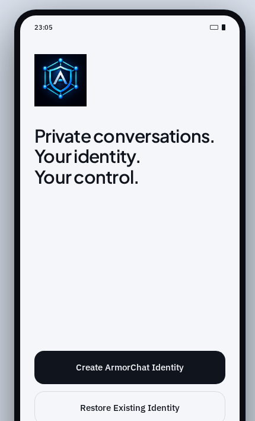

# ArmorChat

**Private conversations. Your identity. Your control.**

ArmorChat is the Android messenger from CodeYantra Technologies. The identity is created on the phone. The private key stays there. A conversation is sealed before it leaves the device, and the service that carries it never has to read it.

<p align="center">
  
</p>

## ArmorChat 0.6.0

0.6.0 is the version that stands the product up in public. It is not a concept shell and not a web demo. It is the Android app: a key you hold, a contact you check, and a conversation that does not depend on CodeYantra reading it.

### What this version puts in your hands

- **An identity that never becomes an account.** ArmorChat creates an Ed25519 key on the device and wraps it with the Android Keystore. There is no remote master key. A backup is a password-protected file you keep, not a copy sitting on our servers.
- **A contact you verify yourself.** You exchange a QR. The app checks that the code matches the key. That check proves the key, not the legal name of the person holding the other phone. Trust is still your decision.
- **One-to-one messages sealed with MLS.** Application messages use MLS (RFC 9420, mls-rs) on the device. The CodeYantra relay stores and forwards ciphertext. It is a delivery service, not a reader of the chat.
- **Photos, files, and voice notes.** They are encrypted before they move. Large files travel in chunks, so one long recording is not one fragile upload.
- **A path when the network is down.** Emergency Mesh can carry a sealed message between nearby phones. In this version that is a direct handoff from one phone to another. It is not an anonymous network, and it is not a promise that a message will cross a chain of strangers.

Veltrix is the trust layer behind that relay. It moves ciphertext. It is not a surveillance console.

### What 0.6.0 does not claim

Serious software says this out loud.

- Armor Deal, the agreement flow inside a chat, is **not** in the production app. It is not an IT Act electronic signature, not Aadhaar eSign, and not proof of a legal name.
- ArmorChat is not anonymous and not untraceable. A network observer can still see that a phone connected, and when. The relay can see mailbox metadata. It cannot read the message.
- An unlocked, compromised, or rooted phone can show what the app can show. A screenshot, a recording, or a person you already trust can carry the words out of the app.
- Groups and calls are not in this version.

The limits are written down in [android/SECURITY.md](android/SECURITY.md) and [android/docs/THREAT_MODEL.md](android/docs/THREAT_MODEL.md). Older notes in `android/docs/` describe the phases that built this tree. Where a note still says messaging is unimplemented, this page is the current statement.

## Who stands behind it

| Name | Role |
| --- | --- |
| ArmorChat | The product |
| CodeYantra Technologies | Owner, developer, and publisher |
| Veltrix | Trust layer for the relay. Ciphertext in, ciphertext out. |

## Build

The app lives in [`android/`](android/). JDK 17, Android SDK 36, and the Gradle wrapper are enough.

```bash
cd android
./gradlew assembleDebug
./gradlew test
```

The pilot package is arm64-v8a. Minimum SDK is 26.

## Security

Report a vulnerability privately to CodeYantra Technologies. Do not open a public GitHub issue for it. See [android/SECURITY.md](android/SECURITY.md).

## License

Apache License 2.0. See [android/LICENSE](android/LICENSE), [android/NOTICE](android/NOTICE), and [android/THIRD_PARTY_NOTICES.md](android/THIRD_PARTY_NOTICES.md).

The license does not grant rights in the ArmorChat, CodeYantra Technologies, or Veltrix names or logos.
