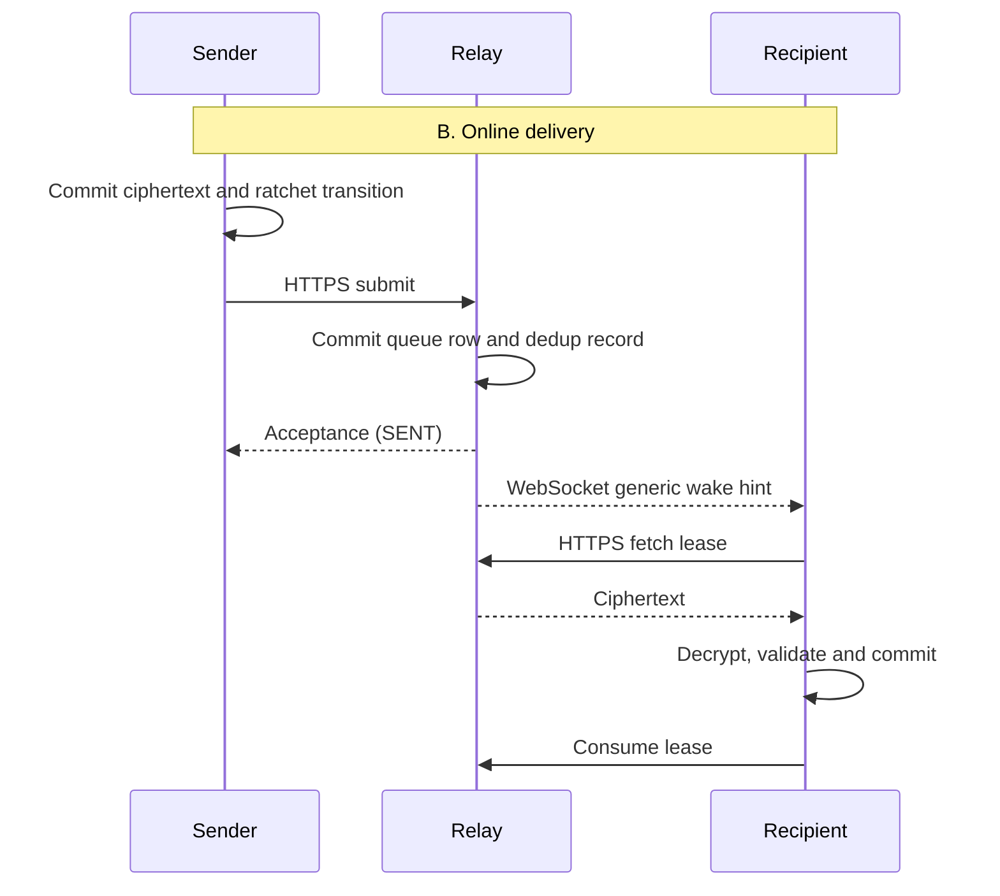

# ArmorChat messaging protocol — Phase 1D.0

Status: **architecture proposal; no messaging implementation or production security claim**.
Decision date: 2026-09-05. Scope: one Android device per identity, one-to-one text.
Normative MUST/MUST NOT statements describe requirements for subsequent phases.
Read with [Relay architecture](RELAY_ARCHITECTURE.md) and
[Threat model](THREAT_MODEL.md). All numeric limits below are proposed ArmorChat
policy, not upstream protocol defaults.

## 1. Decision report

1. **E2EE/session approach:** **Reopened (2026-09-06).** Stable Olm v1 is not
   acceptable (64-bit MAC). Production messaging must use a library protocol
   with ≥128-bit authentication, delegated intact — no ArmorChat-written
   ratchet/KDF/MAC, and no Ed25519-to-X25519 conversion. Existing ArmorChat
   Ed25519 identity only signs device/leaf credentials. See
   [crypto replacement review](MESSAGING_CRYPTO_REPLACEMENT.md).
2. **Library:** **No production enablement.** vodozemac 0.10.0 remains only as
   the isolated 1D.1 harness. **libsignal is AGPL-3.0** and stays excluded.
   Local A↔B spike selected **mls-rs 0.56.0** (RFC 9420) as the next path;
   OpenMLS 0.9.0 also passed and is the fallback. See
   [MLS shootout](MLS_SHOOTOUT.md). Not a relay and not enabling `CryptoEngine`.
   Retain Tink 1.21.0 for identity signing/storage.
3. **Identity binding:** pinned full Ed25519 key verifies a device credential;
   that credential binds independent Olm keys. Device-signed one-time prekeys and
   routing invitations bind the same device generation. Both peers verify pins.
4. **Addressing:** random per-contact ingress mailbox, independent device ID and
   relay management credential. No public ac1 directory. Separate signed invite
   solves discovery; the existing identity QR alone cannot route messages.
5. **Envelope:** strict versioned JSON outer routing wrapper; opaque library
   ciphertext contains authenticated application IDs, participants and context.
   See the relay document for exact fields and byte limits.
6. **States:** SENT is authenticated relay acceptance; DELIVERED is recipient
   durable acceptance plus E2EE receipt; READ is recipient client view receipt.
7. **Replay:** library ratchet checks plus persistent session-bound IDs, ciphertext
   digests and retired-session tombstones; timestamps alone never authenticate.
8. **Offline/retry:** transactional outbox, exact-byte resubmission, bounded
   exponential backoff, leased inbox and persistent deduplication; seven-day TTL.
9. **FCM:** optional generic wake-up only; foreground fetch works without Google.
10. **Suspension:** relay availability only. No local wipe, escrow, or kill switch.
11. **Transport:** HTTPS submission/fetch/consume, foreground WebSocket wake hints,
    HTTPS polling fallback, lifecycle-aware background work.
12. **Unresolved:** adapter audit, storage rollback, device recovery/revocation
    freshness, prekey exhaustion, and metadata exposure remain explicit release
    gates. **The 64-bit Olm MAC budget is resolved as C (reopen);** it is not an
    open “maybe acceptable with rate limits” item. See
    [Olm MAC security gate](OLM_MAC_SECURITY.md).
13. **Phase 1D.1 first:** isolated library/identity-binding and transactional-state
    feasibility tests, before connecting real chat UI or implementing a relay.

## 2. Current repository boundary

The foundation uses Tink Ed25519 sealed by Android Keystore, ac1 derived from a
128-bit truncated public-key hash, pinned full keys in contacts, and identity-only
backup. See [Identity security](IDENTITY_SECURITY.md),
[Contact exchange](CONTACT_EXCHANGE.md), and [Chat UI](CHAT_UI.md).
`MessageStatus` already names the seven states below. `NoOpMessageTransport` and
`UnimplementedCryptoEngine` MUST remain the production bindings in this phase.
The Phase 1D.2 relay lives in `android/relay/` and is documented in
[RELAY_IMPLEMENTATION.md](RELAY_IMPLEMENTATION.md). Phase 1D.3 adds a
**test-only** two-phone MLS proof ([TWO_PHONE_MESSAGING_TEST.md](TWO_PHONE_MESSAGING_TEST.md));
it is not wired to production chat UI.
The stateless `CryptoEngine.encrypt(plaintext, recipientPublicKey)` placeholder
is insufficient for sessions. `MessageTransport` currently carries a local
`conversationId`; it MUST NOT serialize that local database ID onto the network.

Existing Room `MessageEntity.localPlaintext` is a placeholder, not encrypted
message storage. A future migration must introduce protected content and atomic
session/outbox state before storing real text; no plaintext fallback.

## 3. Library evaluation and licensing

Versions are the concrete versions examined, not a guarantee that a moving
upstream `latest` endpoint is complete or that artifacts build on this project.
Upstream releases/source were checked on the decision date. No application source
from Signal, Session or BChat is imported or copied.

| Candidate / examined version | Maintenance and Android | Cryptographic properties | Operational cost / Apache-2.0 suitability |
| --- | --- | --- | --- |
| **vodozemac 0.10.0** | Maintained; Android JNI harness exists in-tree. | Olm v1: 64-bit truncated HMAC. **Rejected for production.** Experimental v2 is not a stable spec. | Apache-2.0. Do not enable `CryptoEngine` on this library. |
| **libsignal 0.102.0** | Active Signal release line; upstream Java/Android native packages. Upstream explicitly does not support outside use and APIs may change. | Signal session protocol with ratcheting and modern post-quantum work; exact negotiated suite must be checked, not inferred from package name. | High integration/update burden. **AGPL-3.0 copyleft**: excluded from current Apache-only distribution plan unless licensing/distribution strategy is separately resolved. |
| **Matrix Rust SDK 0.18.0** (`matrix-sdk-crypto` family) | Active, production use including Android through SDK bindings; standalone crypto state machine exists. | Olm/Megolm orchestration and Matrix device trust; using room encryption is not equivalent to pairwise Olm security. | High domain mismatch: Matrix device/room/sync semantics and larger dependency surface. Apache-2.0 at SDK level; viable if adopting Matrix, not selected for this minimal relay. |
| **OpenMLS 0.9.0** | Maintained (Phoenix R&D / Cryspen). CI builds Android triples; no official Kotlin API. | IETF MLS RFC 9420; AES-GCM / ChaCha20-Poly1305 (128-bit tags); KeyPackage/Welcome async setup; FS/PCR via epochs. | MIT. **Spike candidate** — see [crypto replacement](MESSAGING_CRYPTO_REPLACEMENT.md). |
| **mls-rs 0.56.0** | Maintained (AWS Labs). UniFFI helper; RustCrypto provider avoids extra native crypto. | Same RFC 9420 suites and async model as OpenMLS. | Apache-2.0 OR MIT. **Spike selected (next path).** No third-party implementation audit yet. See [MLS shootout](MLS_SHOOTOUT.md). |

Sources: [vodozemac release](https://github.com/matrix-org/vodozemac/releases/tag/0.10.0),
[vodozemac project](https://github.com/matrix-org/vodozemac),
[tagged manifest and features](https://raw.githubusercontent.com/matrix-org/vodozemac/0.10.0/Cargo.toml),
[libsignal release](https://github.com/signalapp/libsignal/releases/tag/v0.102.0),
[libsignal supported use and packaging](https://raw.githubusercontent.com/signalapp/libsignal/v0.102.0/README.md),
[libsignal license](https://raw.githubusercontent.com/signalapp/libsignal/v0.102.0/LICENSE),
[Matrix SDK release](https://github.com/matrix-org/matrix-rust-sdk/releases/tag/matrix-sdk-0.18.0),
[Matrix SDK architecture and license](https://github.com/matrix-org/matrix-rust-sdk).

Existing supporting dependencies (not complete session candidates): Tink Android
1.21.0 (Apache-2.0), Bouncy Castle 1.81 (Bouncy Castle permissive license), OkHttp
4.12.0 (Apache-2.0), WorkManager 2.10.3 (Apache-2.0), Room 2.8.4 (Apache-2.0), as
recorded in this repository's version catalog and
[third-party inventory](../THIRD_PARTY_NOTICES.md). They do not supply a complete
ratcheting messenger. Their continued use does not establish current security
patch status. JNI can use the platform interface directly; no unreviewed binding
package or floating bridge version is approved here. FCM is deferred and would
need a separate SDK/terms/dependency review.

Before adding the selected library: lock Cargo graph/checksums, inspect all
transitive licenses/features/native artifacts, preserve notices in the APK,
verify minSdk 26, arm64-v8a and x86_64 (plus any advertised additional ABI), 16-KiB
page-size support, release/R8 packaging, process-death handling, zeroization and
panic-to-typed-error behavior. Disable unused compatibility features after
checking tagged APIs. Native feasibility failure reopens the decision; do not
write a substitute ratchet.

### Selected protocol limitations

Use the documented stable `SessionConfig::version_1()` consistently at both ends
**only inside the isolated 1D.1 harness**. It uses an **8-byte (64-bit)
truncated HMAC-SHA256**, not a 128-bit authentication tag. Do not claim
full-length AEAD authentication or silently enable experimental algorithms
(`SessionConfig::version_2()` is feature-gated and is not a silent upgrade).

**MAC gate (2026-09-06): C — not acceptable.** Reopen the messaging
crypto/library choice before any production E2EE. Do not extend this MAC
locally, wrap Olm ciphertext in a second ArmorChat authenticator, or treat
relay/client rate limits as authentication. Quantified forgery budgets,
assumptions, and the 128-bit comparison are in
[Olm MAC security gate](OLM_MAC_SECURITY.md).
Replacement research (decision **B**, spike OpenMLS and mls-rs):
[MESSAGING_CRYPTO_REPLACEMENT.md](MESSAGING_CRYPTO_REPLACEMENT.md).
See [upstream configuration](https://matrix-org.github.io/vodozemac/vodozemac/olm/struct.SessionConfig.html).

Olm is not X3DH or PQXDH: do not bolt Signal signed-prekey equations onto it.
Our certificate/signatures authenticate the public inputs to the library's
existing setup. Classical Double Ratchet forward secrecy depends on deleting
old keys; post-compromise recovery requires fresh honest DH contributions after
the attacker loses access. It is not immediate, is weaker during one-way/offline
traffic, and does not repair stolen long-term identity authority. No post-quantum
claim. See [Double Ratchet security considerations](https://signal.org/docs/specifications/doubleratchet/).

## 4. Key hierarchy and signed objects

| Material | Owner / purpose / lifetime |
| --- | --- |
| ArmorChat Ed25519 identity | Existing long-term user identity; signs device credentials only for this protocol. Full pinned key is authoritative, never ac1 alone. |
| Olm account Ed25519 + Curve25519 keys | Fresh library-generated device keys, independent of ArmorChat identity. Device signing and library key agreement respectively; stable for device generation. |
| One-time Curve25519 keys | Generated/consumed by Olm; device-signed before publication. Required for new sessions; no reusable fallback in phase 1D. |
| Ratchet roots/chains/message keys | Entirely library-managed; never exported to UI, relay or backup. Delete according to library lifecycle. |
| Storage data key | Random per-install key wrapped with Keystore; protects message content and library state. Separate from identity KEK and relay credentials. |
| Relay credentials | Random scoped owner and per-contact submit capabilities; transport authentication only, not identity proof or E2EE keys. |

`Account` exposes creation, key publication and inbound/outbound session APIs;
it can evict old one-time keys if overfilled. Maintain capacity without evicting
keys still needed by accepted offline envelopes. See
[upstream account API](https://matrix-org.github.io/vodozemac/vodozemac/olm/struct.Account.html).

Signed objects use RFC 8785 JCS UTF-8 canonical JSON, via a tested implementation,
with signature excluded from the signed body. Sign bytes
`ASCII(context) || 0x00 || JCS(body)` using the named Ed25519 key. This is application
credential framing, not a new encryption primitive. Context values are exactly
`ArmorChat/device/v1`, `ArmorChat/prekey/v1`, `ArmorChat/route/v1` respectively.
Reject unknown/duplicate fields, invalid UTF-8, floats and noncanonical key/token
encodings before verification. Integers are unsigned, <= 2^53-1. Signature is raw
64-byte Ed25519, Base64URL unpadded; verify Tink output-prefix handling against
raw Ed25519 vectors before implementing (do not strip arbitrary bytes).
[JCS specification](https://www.rfc-editor.org/rfc/rfc8785).

Device credential body, all fields required:

- `v=1`, `suite="ac-olm-v1"`, `identity_key` (32 bytes), `device_id` (16 random
  bytes), `generation` (positive integer), `device_signing_key` (32 bytes),
  `device_agreement_key` (32 bytes), `issued_at`, `expires_at` (epoch seconds).
- Identity signature covers the entire body. Lifetime at most 90 days; renew
  with same keys/generation. New keys require a new generation and device ID.
- Credential fingerprint is SHA-256 of its canonical body. Compare actual key
  tuple as well as generation on renewal; renewal must never change keys silently.

Prekey body, signed by device signing key:
`v=1`, `suite`, `device_id`, `generation`, `device_agreement_key`, `prekey_id`
(canonical library identifier encoded as a string, <=128 UTF-8 bytes),
`prekey_public` (32 bytes), `issued_at`, `expires_at`. Maximum validity seven days;
expiry cannot exceed credential expiry. The verified credential supplies its
signing key. Library key validation must reject invalid agreement inputs.

Route body is defined in the relay document and signed by device signing key.
Every signature is checked against the pinned identity chain, not keys provided
by the relay as a new trust anchor. A valid signature proves authority, not that
an object is the newest: store generation and route-revision high-water marks.
Clock uncertainty beyond five minutes blocks new setup with a clock error, not
an insecure bypass. For delayed inbound setup, verify signatures first and
require the authenticated inner `created_at` to fall within the credential,
prekey and route validity windows; message expiry must be at most creation +
seven days and still live. This permits an offline envelope arriving after its
prekey publication expires, while bounding backdating. Retained old key material
is only for that drain window; sender must use currently valid inputs. Local
generation/revision revocation decisions still override a valid old signature. Offline first-use cannot guarantee freshness against a
malicious relay without an independent recent invitation.

## 5. Contact binding and first session

Prerequisite: **mutual full-key pins** from verified contact exchange, plus a
separate authenticated route invitation. Unknown senders cannot auto-create
contacts or chat sessions. Bare ac1 is not a directory request. The existing v1
QR parser still accepts exactly its four fields; do not sneak routing fields
into it. New route invitations need their own versioned parser/UI in a later phase.

Sender verifies recipient credential under the saved key, expected device
and generation, signature/expiry of the prekey, and signed mailbox capability.
Recipient verifies sender credential against its own saved contact and matches
the sender's Curve25519 key with the library prekey-message header. Both bind the
recipient key/device and setup context inside authenticated encrypted content.
Relay-selected keys never bypass these checks.

Phase 1D permits one outstanding initiation per contact/device pair. Publish a
batch of 50 prekeys if library capacity permits; replenish below 20, without
exceeding capacity or deleting live keys. Claim atomically and idempotently using
a random 16-byte `claim_id` scoped to submit capability. Lost claim responses
return the same prekey. Never give an allocated key to a different claim.
No prekey available => queued `WAITING_FOR_PREKEY`; existing sessions continue.
Persist private keys before publication; retain unused expired keys until their
expiry + seven days + five-minute skew, unless securely consumed earlier. Pause
replenishment if safe capacity is exhausted. Never regenerate evicted keys.

```mermaid
sequenceDiagram
    participant A as Sender
    participant R as CodeYantra Relay
    participant B as Recipient
    Note over A,B: A. Mutual identity pins and separate signed route invites
    B->>B: Generate Olm account; identity-sign credential; seal keys
    B->>R: Register mailbox and signed one-time prekeys
    A->>R: Claim prekey using route capability and stable claim ID
    R-->>A: Credential and signed prekey
    A->>A: Verify pin, route, generation, signatures and expiry
    A->>A: Library creates outbound session; encrypt setup and first text
    A->>A: Commit new session state and exact ciphertext outbox atomically
    A->>R: Submit immutable prekey envelope
    R-->>A: Durable relay acceptance (SENT)
    R->>B: Lease ciphertext
    B->>B: Verify sender pin; library inbound setup; validate encrypted context
    B->>B: Commit consumed prekey, session, message and receipt intent atomically
    B->>R: Consume lease; submit encrypted delivery receipt
    R->>A: Receipt ciphertext
    A->>A: Verify recipient receipt (DELIVERED); session confirmed
```

Before confirmation, send only the first text; queue additional texts so an
adversarial relay cannot create many pending prekey sessions. Library-produced
session ID is opaque; do not calculate your own replacement. Retain at most two
sessions per device pair for simultaneous initiation. After both are confirmed,
use lexicographically smaller library session ID for new outbound text; accept
inbound messages on either during seven-day drain, then retire the other. Never
re-encrypt already-submitted messages merely to converge sessions. More setup
attempts require a user-visible recovery decision. Duplicate setup must match an
existing session and durable digest, not consume a new prekey.

## 6. Authenticated inner records

Strict JSON UTF-8, max 16 KiB including padding; no compression. Every record has
`v=1`, `suite`, `kind` (`text`, `delivery`, `read`), `message_id` (16 random bytes),
`session_id` (library opaque ID, <=128 bytes), sender/recipient `device_id` and
`generation`, sender/recipient full `identity_key`, `recipient_mailbox`,
`created_at`, `expires_at`, and `body`. These fields are encrypted and authenticated
by the library. Optional padding is encoded in a fixed allowed `padding` string;
proposed bucket sizes 1/2/4/8/16 KiB bound size leakage without claiming anonymity.

`text.body` contains only `text` (1–4096 UTF-8 bytes; reject invalid Unicode) and
`client_sequence` (positive per-sending-device conversation integer, persisted).
Receipts contain `target_message_id`, `target_session_id`,
`target_ciphertext_sha256` and `event_at`. Each receipt has its own independent
message ID. No text receipts for receipts: transport consume is sufficient.

After decrypt, compare inner version, suite, message ID, mailbox and expiry to
outer fields and compare participants/session against local verified context.
Mismatches reject the entire record before message/ratchet commit. The outer
wrapper is not assumed to be library AAD. Its protected copies inside ciphertext
provide context binding; no invented library AAD API. If a header is changed to
an unsupported version it can cause denial of service, not plaintext acceptance.
First prekey envelope includes the sender credential outside encryption for
pin checking; the inner sender/recipient keys still prevent reflection and
unknown-key-share acceptance. Established-session credentials stay off the wire.

The library returns authenticated plaintext from session decrypt. Mutations occur
on a staged state snapshot and are committed only with validated application
content. See [session API](https://matrix-org.github.io/vodozemac/vodozemac/olm/struct.Session.html).

## 7. Delivery authority and state machine

| State | Sole authoritative event / behavior |
| --- | --- |
| QUEUED | Local protected outbox intent committed, including offline/prekey wait. |
| ENCRYPTING | Worker preparing session and ciphertext; no network success implied. |
| SENDING | Committed ciphertext is undergoing a network submission attempt. |
| SENT | TLS-authenticated relay acceptance identifies the exact envelope digest and says durable storage committed. A malicious relay can lie about its own storage. |
| DELIVERED | Pinned recipient session authenticated a receipt for the exact message/session/ciphertext after durable decrypt-and-accept. Relay fetch or delete is insufficient. |
| READ | Authenticated recipient receipt after app was foreground, conversation visible, and that message rendered in viewport. User may disable receipts. This is client-reported viewing, not proof of human comprehension. |
| FAILED | Permanent failure or automatic retry exhaustion before known relay acceptance; retains reason, retryability, last attempt and ambiguous-acceptance flag. Does not prove recipient never received it. |

Normal flow: QUEUED → ENCRYPTING → SENDING → SENT → DELIVERED → READ.
Transient attempts return to QUEUED with `retryAt`, not FAILED immediately.
SENT never becomes FAILED because a recipient is offline; keep highest evidence
and annotate `expired_without_receipt` / `delivery_unknown`. Separate attempt state
from monotonic delivery evidence. A valid late receipt can move FAILED directly
to DELIVERED/READ even when relay ACK was lost; do not fabricate a SENT timestamp.
READ implies durable delivery and can supersede a lost/reordered delivery receipt.
Duplicate/older receipts never regress state. User retry preserves original
ciphertext/ID until expiry; sending after expiry is a new message with an explicit
possible-duplicate warning when prior acceptance was ambiguous.

Recipient creates delivery intent in the same transaction as message acceptance.
Read intent is durable only for accepted messages actually viewed while receipts
are enabled. Returning online flushes those intents. Match target identity,
devices, generation, session, message ID and ciphertext hash to a known outbound
message; reject orphan or mismatched receipts. No relay boolean can set these
states. A malicious recipient can misreport its own reading; a relay without
session secrets cannot normally forge a valid recipient receipt.



```mermaid
sequenceDiagram
    participant A as Sender
    participant R as Relay
    participant B as Recipient
    Note over A,B: D. End-to-end acknowledgements
    B->>R: Encrypted delivery receipt
    R->>A: Leased receipt
    A->>A: Authenticate exact target; commit DELIVERED
    A->>R: Consume receipt lease (no E2EE ACK loop)
    B->>B: User views message; persist read intent if enabled
    B->>R: Encrypted read receipt
    R->>A: Leased receipt
    A->>A: Authenticate exact target; commit READ
    A->>R: Consume receipt lease
```

## 8. Crash consistency, replay and order

One serialized crypto worker per account coordinates prekey changes; one per
session coordinates ratchet use. Storage transaction contains sealed library
state, version/CAS counter, immutable ciphertext outbox or inbound message,
dedup ledger and pending receipt intent. Never send before commit. Never delete
relay ciphertext before local acceptance commit. On transaction failure discard
mutated in-memory state and reload committed state. Encryption retry resumes
stored bytes; it does not advance the ratchet again. Library account changes
(prekey consumption) and session creation MUST share the transaction.

Store these conceptual records (schema/migrations deferred): sessions with sealed
state/version/device binding; outbox with exact envelope/digest/attempt schedule;
inbox with unique `(peer full key, peer generation, session_id, message_id)`;
receipt intents; highest delivery evidence; device/route high-water marks;
retired-session tombstones. Protect content and crypto blobs with an established
AEAD storage API, random nonces and record-purpose/ID/version AAD. Room transaction
must include ciphertext blobs themselves, not a nonatomic reference to a newly
written state file. Journals/WAL and crash logs must never receive plaintext.

For duplicate outer IDs, check stored authenticated ciphertext digest before
ratchet decrypt. Exact match may requeue the existing receipt and consume the
lease; never redisplay text. Different ciphertext with the same identity/session
ID is rejected even if decryptable. Enforce outbound uniqueness too. An outer ID
alone does not reserve an inbox ID: malformed messages cannot poison dedup state.
Rewrapping old ciphertext under a fresh outer ID fails inner-ID equality or the
ratchet's replay check. Never restore old keys to process a replay.

Allow reordered library messages within a bounded skipped-key window. Adapter
must demonstrate <=1,000 skipped keys per session, <=2 MiB serialized session,
and <=2 retained sessions per device pair without modifying crypto internals.
If stable APIs cannot enforce these budgets safely, this is a library-selection
gate. Reject excessive gaps with a typed error and retain message-loss warning;
do not silently reset. Limit setup attempts to 5/contact/hour and invalid decrypts
to 20/contact/minute locally, even if relay ignores its own limits. These limits
are availability tradeoffs, not a substitute for MAC analysis.

Sequence numbers are display/order hints authenticated per device; gaps do not
block valid later text. Timestamps are not total order. Show late arrivals without
rewriting previously observed receipt evidence. Receipt ordering is independent.

Keep dedup digests through envelope expiry + seven days + five minutes; skipped
keys no longer than seven days. Keep retired-session IDs and generation marks
for the device lifetime, even after deleting visible chat history. Old sessions
must not be recreated from a replayed prekey packet. Bound growth and require
explicit device/session renewal if limits are reached, not silent tombstone loss.

Keystore encryption does **not** prove freshness of an old valid state blob.
Transactional storage prevents ordinary crash rollback, not restoration of an
entire authenticated filesystem snapshot. Sessions are excluded from identity
backup and Android backup. Restore creates fresh device/account/mailbox and
requires peer approval. Detected state/version inconsistencies halt messaging;
undetectable OS-level rollback is outside the guaranteed threat model.

## 9. Identity change, device loss and recovery

A different Ed25519 key normally produces a different ac1. The same local name,
phone, route or relay account is not identity continuity. Show **“Security identity
changed”**, block new sends/session setup, preserve old pin/history and do not
retarget queued ciphertext. User must independently verify a new QR and explicitly
create/accept a new identity relationship. Even an ac1 collision cannot replace
the saved full key. Existing sessions cannot promote a new identity automatically.

A new device key signed by the same identity is a different event: **“Messaging
device changed”**. Require explicit peer approval in phase 1D, pin its generation,
retire old sessions and obtain new routes. Identity restore restores neither old
session secrets nor contacts/history; no old relay ciphertext can be promised
readable. Lost-device owner credentials can be revoked when available; signed
replacement alone cannot force a malicious relay or offline peer to forget old
credentials. Independent re-verification is necessary after identity-key theft.
Simultaneous restored copies are unsupported; never merge their ratchets.

## 10. Phase 1D.1 gates and acceptance work

First implement only an isolated, non-shipping feasibility harness once that
phase is authorized. Use upstream APIs/test vectors and independently reviewed
application binding vectors. Required before enabling real messaging:

- Prove two Android instances establish a session using current pinned Tink keys;
  test altered device/prekey/route signatures, wrong recipient, reflection, wrong
  version, expired credentials and raw Ed25519 signature interoperability.
- Verify exact stable-library config, native ABI/runtime support and transitive
  license/security inventory. **MAC budget sign-off is C (reopen)** —
  [Olm MAC security gate](OLM_MAC_SECURITY.md). Application identity/session
  binding still needs its own review; upstream audit does not cover it.
- Crash at every pre/post transaction and network boundary; outbox ciphertext
  must stay identical and inbound message/receipt intent occur exactly once.
- Exercise reorder, replay, duplicate IDs, simultaneous initiation, exhausted
  prekeys, missed ACK, malformed lengths, skipped-key limits and lost receipts.
- Test identity-only restore, corrupt/missing KEK and generation rollback; fail
  closed without wiping identity or silently creating fresh sessions.
- Freeze canonical-object and wire fixtures, storage migration/protection choice,
  retention budgets, relay durability contract and battery behavior before relay
  implementation. Do not advertise production E2EE until reviewed end to end.

Attachments/voice notes may later use encrypted blob references; groups require
a separately reviewed group protocol and membership model; WebRTC calls need
separate signaling/media key design. Reserve versioned inner content kinds, but
v1 rejects unknown kinds. None are implemented or deeply specified here.
